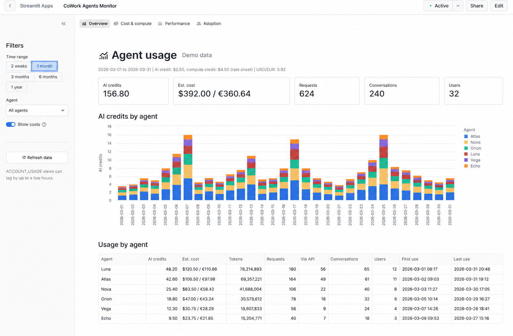
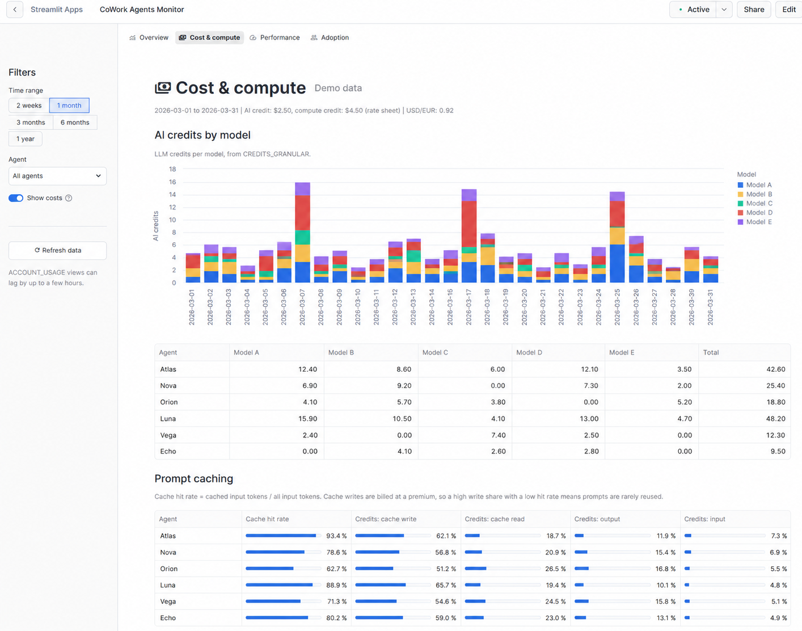
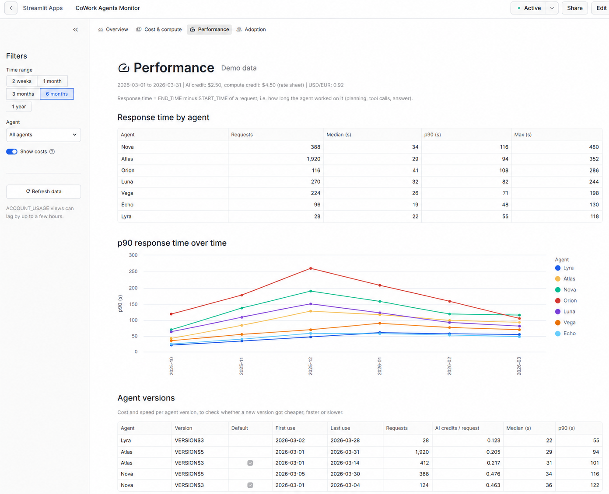
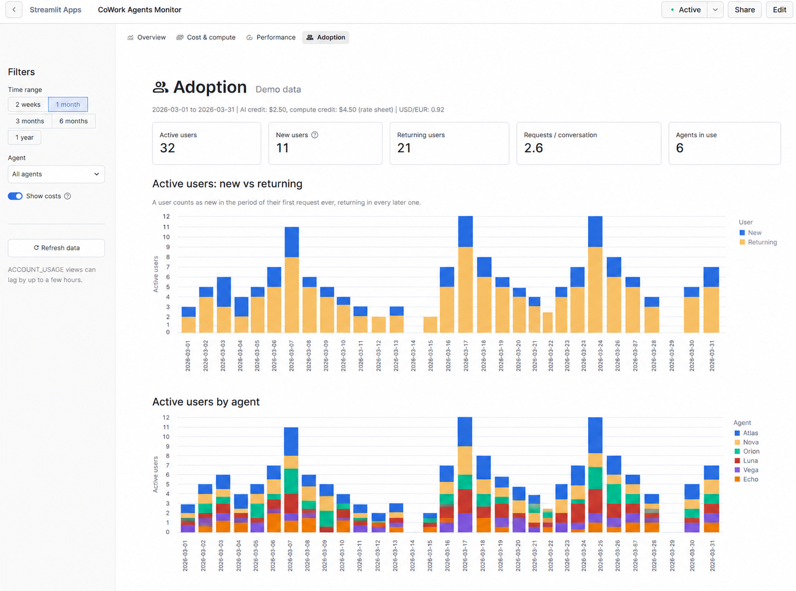

# CoWork Agents Monitor

A Streamlit in Snowflake app to monitor usage, cost and performance of **Cortex Agents in Snowflake Intelligence (CoWork)**.

The app discovers agents on its own from `SNOWFLAKE.ACCOUNT_USAGE`. When you create a new agent, it shows up in the monitor as soon as it is used, with no code change.

It covers both ways agents are used:

- **CoWork** (Snowflake Intelligence UI): `SNOWFLAKE_COWORK_USAGE_HISTORY`
- **API** (direct Cortex Agent calls, e.g. REST or testing in Snowsight): `CORTEX_AGENT_USAGE_HISTORY`



*Screenshots show demo data.*

## Pages

| Page | What it shows |
| --- | --- |
| **Overview** | AI credits, estimated cost, requests, conversations and users per agent (or per user for a single agent), including direct API calls |
| **Cost & compute** | Credits per LLM model, prompt cache hit rate and cost share of cache writes, SQL compute per agent, and warehouse utilization (metered vs used by agents, auto-suspend) |
| **Performance** | Median and p90 response time per agent, p90 trend, and cost and speed per agent version |
| **Adoption** | Active, new and returning users, active users per agent, requests per user and per conversation |

All pages share the sidebar filters: time range (2 weeks to 1 year, charts by day, week or month), agent, and a "Show costs" toggle for a management view without cost figures.

Optionally, a scheduled task emails a usage report (see [Email report](#6-optional-email-report)).

<details>
<summary>Screenshots of all pages</summary>

### Overview


### Cost & compute



### Performance



### Adoption



</details>

## Quick start

For the impatient. Each step is explained in detail under [Setup](#setup).

```bash
git clone https://github.com/dataregulator3/snowflake-cowork-agents-monitor.git
cd snowflake-cowork-agents-monitor

# 1. Fill in the placeholders in setup.sql and run it as ACCOUNTADMIN
# 2. Optional: edit config.py (works without changes)
# 3. Set query_warehouse in snowflake.yml
snow streamlit deploy --replace --database <APP_DATABASE> --schema <APP_SCHEMA> --role AGENTS_MONITOR_ROLE
```

Then open `COWORK_AGENTS_MONITOR` from the Streamlit apps list in Snowsight.

## Requirements

| What | Why | Default |
| --- | --- | --- |
| A Snowflake account with Cortex Agents in use | Data source | |
| `ACCOUNTADMIN` (once, for `setup.sql`) | Creates the role, grants and PyPI integration | |
| [Snowflake CLI](https://docs.snowflake.com/en/developer-guide/snowflake-cli/index) with a working connection | Deploys the app | |
| A warehouse | Runs the app's queries. An X-Small is enough. | |
| A compute pool | Runs the Streamlit container | `SYSTEM_COMPUTE_POOL_CPU`, exists in every account |
| An external access integration to PyPI | The container installs the dependencies from `pyproject.toml` at startup | Created by `setup.sql` as `PYPI_ACCESS_INTEGRATION` |

No `environment.yml` is needed. That file is only used by the older warehouse runtime.

## Setup

### 1. Get the code

```bash
git clone https://github.com/dataregulator3/snowflake-cowork-agents-monitor.git
cd snowflake-cowork-agents-monitor
```

Check that the Snowflake CLI can reach your account:

```bash
snow connection test -c <connection>
```

If you have no connection yet, create one with `snow connection add`. All `snow` commands below accept `-c <connection>`; leave it out to use your default connection.

### 2. Create role and grants

Open `setup.sql` and replace the placeholders:

| Placeholder | Meaning | Example |
| --- | --- | --- |
| `<APP_DATABASE>` | Database for the Streamlit app. Created if it doesn't exist. | `MONITORING` |
| `<APP_SCHEMA>` | Schema for the Streamlit app. Created if it doesn't exist. | `APPS` |
| `<APP_WAREHOUSE>` | Warehouse that runs the app's queries | `COMPUTE_WH` |
| `<YOUR_USER>` | User who deploys the app | `JANE_DOE` |

Run the script in a Snowsight worksheet as `ACCOUNTADMIN`.

The script creates the role `AGENTS_MONITOR_ROLE`, which owns the app, and grants it:

- `SNOWFLAKE.USAGE_VIEWER` to read the usage views in `ACCOUNT_USAGE`
- usage on the warehouse, the compute pool and the PyPI integration
- `CREATE STREAMLIT` on the app schema

If your account already has an external access integration for PyPI, skip that block in `setup.sql` and put the name of your integration into `snowflake.yml` under `external_access_integrations`.

**Optional grants** at the end of `setup.sql`:

| Grant | Enables | Without it |
| --- | --- | --- |
| `MONITOR` on your agent warehouse | Shows `AUTO_SUSPEND` on the Cost & compute page | Shows "n/a" |
| `SNOWFLAKE.ORGANIZATION_BILLING_VIEWER` | Your real contract prices from `ORGANIZATION_USAGE.RATE_SHEET_DAILY` | Uses the fallback prices from `config.py` |

The rate sheet is only available in accounts with ORGADMIN enabled (or in the organization account) and not for contracts signed through a reseller.

### 3. Configure

The defaults in `config.py` work out of the box: the app shows every agent in the account and uses fallback prices. Adjust them to your account:

| Setting | Default | Description |
| --- | --- | --- |
| `AGENT_LOCATIONS` | `[]` | Agents to include as `(database, schema, agent_name)` tuples, `None` matches anything. Empty = all agents. |
| `AGENT_WAREHOUSES` | `[]` | Warehouses your agents' tools run on (the warehouse set in the agent's tool configuration). Empty hides the warehouse utilization section. |
| `FALLBACK_AI_CREDIT_PRICE` | `2.00` | Price per AI credit if the rate sheet is not accessible |
| `FALLBACK_COMPUTE_CREDIT_PRICE` | `2.00` | Price per warehouse credit if the rate sheet is not accessible |
| `FALLBACK_CURRENCY` | `USD` | Currency of the fallback prices |
| `SECONDARY_CURRENCY` | `None` | Optional second currency next to costs, e.g. `("EUR", 0.92)` |
| `AGENT_DISPLAY_NAMES` | `{}` | Optional pretty names, e.g. `{"SALES_AGENT": "Sales Assistant"}` |

Example for an account that keeps its agents in `AI.AGENTS` and runs them on `AGENT_WH`:

```python
AGENT_LOCATIONS = [("AI", "AGENTS", None)]
AGENT_WAREHOUSES = ["AGENT_WH"]
FALLBACK_AI_CREDIT_PRICE = 2.50
FALLBACK_COMPUTE_CREDIT_PRICE = 3.00
SECONDARY_CURRENCY = ("EUR", 0.92)
AGENT_DISPLAY_NAMES = {"SALES_AGENT": "Sales Assistant"}
```

Not sure where your agents live? Run `SHOW AGENTS IN ACCOUNT;` and look at `database_name` and `schema_name`.

### 4. Deploy

Set `query_warehouse` in `snowflake.yml` to your `<APP_WAREHOUSE>`, then run:

```bash
snow streamlit deploy --replace --database <APP_DATABASE> --schema <APP_SCHEMA> --role AGENTS_MONITOR_ROLE
```

This creates the Streamlit object `COWORK_AGENTS_MONITOR` and uploads every file listed under `artifacts` in `snowflake.yml`. All of them are required: the entry script imports `config.py`, `data.py` and `charts.py`, and loads the pages from `app_pages/`. If you add files or pages, list them there too.

The command prints the URL of the app. You can also find it in the Streamlit apps list in Snowsight.

The first start takes a minute or two while the container installs the dependencies.

### 5. Share

Grant other roles access to the app:

```sql
GRANT USAGE ON DATABASE <APP_DATABASE> TO ROLE <VIEWER_ROLE>;
GRANT USAGE ON SCHEMA <APP_DATABASE>.<APP_SCHEMA> TO ROLE <VIEWER_ROLE>;
GRANT USAGE ON STREAMLIT <APP_DATABASE>.<APP_SCHEMA>.COWORK_AGENTS_MONITOR TO ROLE <VIEWER_ROLE>;
```

The app's queries run with the owner role `AGENTS_MONITOR_ROLE`, so viewers do not need access to `ACCOUNT_USAGE` themselves. Keep in mind that every viewer then sees usage and user names of all agents in scope.

### 6. Optional: email report

`notification/agent_usage_report.sql` creates a task that sends an HTML email on weekdays at 12:00 and 18:00 (UTC by default) with:

- AI credits, estimated cost, requests and users across all agents
- usage per agent since the first request
- today's usage per agent and user
- usage per agent and user since the first request
- a link to the app

It reads the same views as the app (CoWork and API) and the price from the rate sheet, with a fallback price in the script.

1. Replace the placeholders at the top of the script: `<APP_DATABASE>`, `<APP_SCHEMA>`, `<APP_WAREHOUSE>`, `<RECIPIENT_EMAIL>` and `<APP_URL>` (the URL printed by `snow streamlit deploy`).
2. Optionally adjust the schedule, `fallback_rate`, `currency` and the second currency (`fx_symbol`, `fx_rate`) in the script.
3. Run the script in a Snowsight worksheet as `ACCOUNTADMIN`.

The script creates the email notification integration `AGENTS_MONITOR_EMAIL`, grants the task privileges to `AGENTS_MONITOR_ROLE`, sends one report right away and starts the schedule.

The recipient must be a user in your account with a **verified email address** (Snowsight > your profile). Otherwise `SYSTEM$SEND_EMAIL` fails.

Run it in a worksheet, not with `snow sql -f`: the CLI splits scripts at every semicolon, including those inside the task body.

To stop the report: `ALTER TASK <APP_DATABASE>.<APP_SCHEMA>.T_AGENT_USAGE_REPORT SUSPEND;`

Rerunning the script doesn't change an existing task (`CREATE TASK IF NOT EXISTS`), so the run history is kept. To change the schedule or the report later, suspend the task and use `ALTER TASK ... SET SCHEDULE` or `ALTER TASK ... MODIFY AS`, then resume it. The header of the script shows the commands. Avoid `CREATE OR REPLACE TASK`: it creates a new task object, and Snowsight shows the run history from zero.

### Updating

After changing `config.py` or pulling a new version, run the deploy command from step 4 again. Use **Refresh data** in the sidebar to reload data without redeploying; otherwise data is cached for 5 minutes.

## Troubleshooting

| Symptom | Cause and fix |
| --- | --- |
| App stays on "Starting" or fails to install packages | The container can't reach PyPI. Check that the external access integration in `snowflake.yml` exists and `AGENTS_MONITOR_ROLE` has `USAGE` on it. |
| `Object does not exist or not authorized` on deploy | Missing grants on database, schema, warehouse or compute pool. Rerun `setup.sql` and deploy with `--role AGENTS_MONITOR_ROLE`. |
| "No agent usage in this period" | No requests in the selected time range, or `AGENT_LOCATIONS` doesn't match where your agents live. Try "1 year" and an empty `AGENT_LOCATIONS`. Usage data can lag by a few hours. |
| Header shows "(config)" instead of "(rate sheet)" | The rate sheet is not accessible, so fallback prices are used. See the optional grants in step 2. |
| Auto-suspend shows "n/a" | Missing `MONITOR` on the warehouse, see the optional grants in step 2. |
| Changes in `config.py` don't show up | The app runs the deployed copy. Deploy again. |
| `ModuleNotFoundError` for `data`, `charts` or `config` | A file is missing from `artifacts` in `snowflake.yml`. |
| No report email arrives | Check `SELECT * FROM TABLE(INFORMATION_SCHEMA.TASK_HISTORY()) WHERE NAME = 'T_AGENT_USAGE_REPORT'` for errors. Most common: the recipient's email address is not verified, or it is not listed in `ALLOWED_RECIPIENTS` of the integration. |

## Local development

```bash
python -m venv .venv
.venv\Scripts\activate          # Windows
source .venv/bin/activate       # macOS / Linux
pip install "streamlit[snowflake]>=1.54.0" "altair>=5.5.0" "pandas>=2.2.3"

# Uses a connection from ~/.snowflake/connections.toml
SNOWFLAKE_DEFAULT_CONNECTION_NAME=<connection> streamlit run streamlit_app.py
```

On Windows PowerShell, set the variable with `$env:SNOWFLAKE_DEFAULT_CONNECTION_NAME="<connection>"`.

Locally the queries run with the role of your connection, which needs the same grants as `AGENTS_MONITOR_ROLE`.

## Repository structure

| File | Purpose |
| --- | --- |
| `streamlit_app.py` | Entry point: navigation and shared sidebar filters |
| `app_pages/` | One file per page |
| `data.py` | Queries, caching, filters and formatting shared by all pages |
| `charts.py` | Chart helpers |
| `config.py` | Everything account-specific: agent locations, warehouses, fallback prices, display names |
| `pyproject.toml` | Python dependencies, installed from PyPI by the container runtime |
| `snowflake.yml` | Snowflake CLI project definition for `snow streamlit deploy` |
| `setup.sql` | Role, grants, compute pool access and PyPI integration |
| `notification/agent_usage_report.sql` | Optional scheduled email report (task and email integration) |
| `docs/` | Screenshots for this README (not deployed) |

## How the numbers are calculated

| Metric | Source |
| --- | --- |
| AI credits, tokens | `TOKEN_CREDITS`, `TOKENS` in `SNOWFLAKE_COWORK_USAGE_HISTORY` plus `CORTEX_AGENT_USAGE_HISTORY` |
| Requests | Distinct `REQUEST_ID` across both views (they don't overlap) |
| Via API | Requests from `CORTEX_AGENT_USAGE_HISTORY` |
| Conversations | Distinct `THREAD_ID`. A request without a thread counts as its own conversation. |
| Credits per model, cache hit rate | `CREDITS_GRANULAR` and `TOKENS_GRANULAR`. Hit rate = cache read tokens / (input + cache read + cache write tokens). |
| SQL compute per agent | `METADATA:sql_query_credits` and `METADATA:sql_query_warehouses` |
| Warehouse metered credits | `CREDITS_USED_COMPUTE` in `WAREHOUSE_METERING_HISTORY` |
| Utilization | SQL credits of agent requests on the warehouse / metered credits |
| Response time | `END_TIME - START_TIME` of a request |
| Agent version | `METADATA:agent_version_name` |
| New users | First request ever (over the full history) falls in the selected period |
| Prices | Latest `EFFECTIVE_RATE` for `SNOWFLAKE_COWORK` and `WAREHOUSE_METERING` in `RATE_SHEET_DAILY` |

## Limitations

- **Latency:** `ACCOUNT_USAGE` views can lag by up to a few hours.
- **Utilization is a lower bound for idle time:** metered credits include auto-suspend idle time, the 60-second minimum per warehouse resume, and any non-agent workload on the warehouse. Use a dedicated warehouse for agents to get a meaningful number.
- **Response time** is how long the agent worked on a request, not necessarily what the user perceived.
- **Conversations in older data:** `THREAD_ID` is not filled for every row, so for older periods conversations can be close to the request count.
- **Requests without an agent** (CoWork chats with no agent selected) are not shown.
- **Costs are estimates** based on the rate sheet or your configured prices. Check your Snowflake bill for exact figures.

## License

MIT, see [LICENSE](LICENSE).
